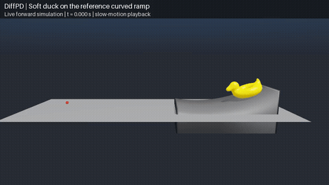
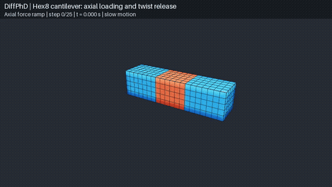
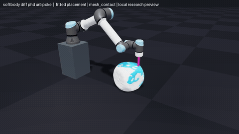

<!-- Generated by tools/build_readme.py; edit pyproject.toml and the sources in docs/. -->
# newton-solver-diff-phd

Differentiable Tet4 mechanics and forward Hex8 projective dynamics for Newton.

## Run

From this directory:

```bash
./docker/build.sh
./docker/run.sh                 # Choose an automatically discovered example.
./docker/run.sh --list          # List examples without Docker or GPU access.
./docker/run.sh <example>       # Run one example.
```

For local development:

```bash
uv sync --locked --extra examples
uv run --locked python -m newton_solver_diff_phd.examples
```

Linux x86-64 or ARM64, Python 3.12. CUDA runs need an NVIDIA driver compatible with the locked CUDA 13 Warp wheel; Docker GPU runs also need NVIDIA Container Toolkit. Use `--cpu --headless` before the example name for supported CPU scenes. Visual Docker runs use the local X11 display and a readable `XAUTHORITY` file. Use `./docker/run.sh -- COMMAND ...` for an arbitrary container command. Source is mounted from this directory; rebuild after changing dependencies.

## Dependencies

Installed runtime packages: `newton==1.7.0`, `warp-lang==1.17.0`, `numpy>=2,<3`. No sibling solver package or external source checkout is required. The `examples` extra supplies the viewer and any USD/robot dependencies; `uv.lock` fixes their versions. Example-specific data requirements are listed below.

## Profiling

```bash
./docker/run.sh --nsys --list
./docker/run.sh --nsys <example>
./docker/run.sh --nsys --all
```

The Docker image includes pinned NVIDIA Nsight Systems CLI 2026.5.1; rebuild older images with `./docker/build.sh`. The profiler runs only examples with README videos, using their recorded settings and scripted interactions. It captures fresh initialization/training and live simulation after independent warmup, with solver/linear-solve/gradient phase markers. The default null viewer retains visualization preparation; add `--viewer gl` to include drawing.

Reports, completion metadata and local history are saved under `nsys/results/` and ignored by Git. See [profiling instructions](nsys/README.md) for local setup, comparisons and reading bottlenecks. Ordinary runs have no profiling instrumentation; captured timings include profiler overhead.

## Example controls and local data

The standard launcher discovers both DiffPhD and DiffPD examples. After `./docker/build.sh`, run
`./docker/run.sh` to select one, or pass its name directly.

Run the original hexahedral cantilever forward benchmark:

```bash
./docker/run.sh softbody_diff_phd_cantilever
./docker/run.sh --headless softbody_diff_phd_cantilever --test
```

The default follows the released `cantilever_3d.py`: 756 vertices and 500 intact
Hex8 cells, a fixed left end, zero gravity, and 25 steps of 0.01 seconds.
The middle 150 cells have Young's modulus 1e7 Pa; the other 350 use 1e6 Pa.
Poisson ratio is 0.45 and density is 1,000 kg/m³. Eight Gauss samples integrate
each cell. The native mean-cell-volume mass convention, 20 bottom-edge muscle
energies with target length zero, and two tip vertex-plane energies are retained.
At step t=0..24, each of the 36 tip vertices receives +X force 80*t/25 N.
Surface triangles are only for display; no tetrahedral subdivision is used.

For the paper's twist-and-release scenario on the same Hex8 environment:

```bash
./docker/run.sh softbody_diff_phd_cantilever --motion twist
```

This option starts with a twist increasing to 30 degrees at the tip and runs
100 steps at 0.001 seconds, without the axial ramp. The smaller twist step
resolves the oscillation that the source axial timestep strongly damps. The paper describes
twist release but its exact initial state is absent from the released Python
script; 30 degrees is an explicit example setting, not a recovered paper value.
Both modes compute fresh forward physics and need no checkpoint or training.
The viewer's **Motion** selector switches between **Axial stretch** and
**Twist release**, restarting the chosen mode. **Replay** restarts it again.
The twist mode uses relative tolerance 1e-6; axial retains the source's 1e-4.
Interactive twist playback holds the initial pose for 1.5 seconds. Mesh edges
and a live tip-rotation readout make the release visible.
The demonstration video shows both complete motions: 25 axial steps followed
by a fresh 100-step twist release. It plays at 24 fps with initial and final
pose holds; these presentation frames do not advance physics. Playback duration
is not a solver-throughput measurement.

The other retained examples are the DiffPD duck and experimental recorded UR5 scene:

```bash
./docker/run.sh softbody_diff_pd_duck
./docker/run.sh softbody_diff_phd_ur5_poke --forward-only
./docker/run.sh softbody_diff_phd_ur5_poke --reference --forward-only
./docker/run.sh softbody_diff_phd_ur5_poke --forward-only --show-target
```

The bear gait, basic block drop and synthetic swept-poke demos have been removed.
The experimental swept-contact extension and its command-line option have also
been removed. The retained UR5 example uses the original penalty contact;
deep penetration remains unresolved.

The UR5 example requires your authorized, prepared PokeFlex recording. Its
optional local default is `examples/assets/pokeflex_local/recording_fine.json`.
The JSON manifest contains relative `geometry`/`recording` paths and SHA-256
checksums; keep the referenced geometry, recording NPZ and the manifest together. A
prepared self-contained NPZ is also accepted. The loader requires rest vertices,
tetrahedra, boundary triangles, pinned nodes, display vertices/triangles/UVs,
fixed tetrahedral embedding, observation frame IDs, target samples and indices,
and the initial XY placement. Missing data produces an explicit error.

The scene follows the original `dice_material_optimize.py` training settings:
two-way `mesh_contact` state forces, a 0.55 mm contact radius, normal stiffnesses
5e3/5e4 N/m, tangential damping 50 N s/m and friction 0.5. The probe has Young's
modulus 1e13 Pa, Poisson ratio 0.45 and density 800 kg/m³. Only its root cap is
prescribed; the other probe particles are elastic. These are penalty contact
equations and do not guarantee zero penetration. The default prepared die and
probe meshes differ from the original script's generated slab and cylinder.

The blue overlay contains measured cube surfaces; the white surface follows
the simulated tetrahedra through an embedded scan surface. That scanned surface
and the tetrahedral collision boundary are slightly different; the original
asset has up to 0.523 mm scan protrusion at rest. Its preparation now uses a
complete containing-cell fallback instead of assuming the nearest 128 cell
centres include the containing tetrahedron. The robot follows the reference script's hand-authored
trajectory. The local recording supplies no measured probe poses or timestamps,
so the 30 Hz timing is assumed. The default initial placement offsets the white
cube by +30 mm in X and +26 mm in Y from the recording, as an initial guess for
position fitting; `--forward-only` does not fit that offset.

Private scans and derived geometry are excluded from release packages and
Docker images; local checkout mounts can access your copy. Use only media
permitted by your dataset access terms. Asset attribution/access notices are in
`src/newton_solver_diff_phd/examples/assets/NOTICE.md`.

Use `--fit-mode position`, `stiffness`, or `compressibility` to fit one parameter
group at a time. `--show-target` overlays the recorded surface. Training saves
`--save-alignment PATH`; `--load-alignment PATH` runs fresh untaped inference.
For live simulation without fitting or a saved checkpoint, use `--forward-only`
with the desired `--initial-xy`, `--young` and `--poisson`. With neither forward
option, the example trains. Forward-only and saved-alignment modes are mutually
exclusive and do not accept training output or gradient-check options.
The prepared recording determines mesh resolution. The default is 30 substeps
per 30 Hz observation with 0.30 retained velocity on every particle after each
substep, including prescribed roots. Independent endpoint positions constrain
the root without replacing the physical velocity used by contact. The forward
iteration budget is 5,000, relative tolerance 1e-4 and Anderson window 5. The optional
`--reference` flag selects a separately prepared mesh and full-scan objective;
it loads `pokeflex_local/recording_reference.json`. The reference preparation
uses the original frame-18 convex hull, 85% decimation, TetGen volume and
24-section cylindrical probe. Both volumes are stored in `die_reference.usdc`;
the companion NPZ contains observations and clamp indices. The offline
`tools/prepare_poke_reference.py` reproduces this preparation from local scans;
it requires PyVista and TetGen in its preparation environment. No runtime
remeshing is performed. Selecting these assets does not establish a successful
full poke or select a different solver. The robot is prescribed visualization
and only the physical probe's root has fixed motion; there is no two-way robot
reaction solve. Alignment files are format version 5, with a physics signature
and a fingerprint of loaded geometry, clamp, motion and observations. Versions
1–4 were fitted with other physics and are rejected; refit them before inference.
The default save path ends in `_v5.json`.
`--contact-tolerance` was removed.

The first live frame builds the sparse solver factors. Preparation has been
accelerated while preserving the factors bit-for-bit, but the larger original
asset still measured about 45 seconds for factor setup alone. The viewer waits during setup; the
terminal now reports its start and completion, then motion progress. The
recording contains 35 frame intervals, or 1.167 seconds of simulated motion.
Afterward the tool holds its final pose while deformable physics continues;
the terminal and GUI explicitly identify that state. Use **Restart poke** in
the example controls to restore the initial state and replay the motion while
reusing the solver factors. Windowed playback remains open after the motion
ends. The viewer's **Pause** control (Space) stops stepping; **Pause Rendering**
freezes only the displayed image.

Training is offline: the viewer pauses for the initial loss/gradient evaluation
and each optimizer update, then replays the stored trajectory. Its FPS includes
those pauses. The terminal and GUI report completed forward/backward times and
rollout counts separately. The default 35 observation intervals at 30 substeps
require 1,050 solver steps per rollout; a line search may repeat the forward
rollout before accepting one update. The first rollout also includes matrix
factorization and graph setup. Inner forward and adjoint iterations use CUDA
conditional graphs when supported; the complete training loop is not captured.
The optional NCP contact correction is skipped for state-only gradients. The
current poke example uses the penalty `mesh_contact` state force instead, whose
reference backward pass holds the force fixed in every fit mode.

`--check-gradients` compares the gradient with central differences that
re-solve contact and recompute nearest associations. The reference gradient
holds each step's contact force fixed. Its heterogeneous mean-weight operator,
Neo-Hookean material formula and original clipping guards are also approximate
derivatives of the executed forward map, so differences need interpretation;
see [validation](docs/validation.md).

## Recording the examples

`python tools/record_examples.py --all` uses `docs/videos.json`. The duck clip
records all 200 steps at 60 fps. The cantilever clip records both complete
motions at 24 fps. The current poke clip uses `--forward-only --show-target`
with the prepared local recording: its initial state and 35 motion intervals
cover all 1,050 physics substeps, played at 15 fps. It uses no fitted checkpoint
and explicitly shows the unresolved penetration under the original penalty law.
It does not establish successful contact or fitted material parameters.

Each clip has held initial and final poses. Sidecar `frames` counts calls to the
example update, while `encoded_frames` includes those extra presentation frames.
Nsight uses the update count and the same motion-switch script, without the
presentation holds. Existing alignment files from older physics need refitting;
inference with a fitted result requires a compatible version-5 alignment.

Poke previews include the private scanned surface. The [dataset access
terms](https://pokeflex.ait.ethz.ch/) restrict use to noncommercial academic
purposes and prohibit redistribution of the dataset and converted models.
These files are local research previews; the terms do not explicitly grant
redistribution rights for rendered movies. No media upload is performed by the
recording tool.

## Reference DiffPhD projective dynamics

`SolverDiffPhD` runs the executed algorithm of the public DiffPhD reference
([Akinesia112/DiffPhD at d319435](https://github.com/Akinesia112/DiffPhD/tree/d319435373a8a94aac2035bfe41f16f49bc1d2a1),
`ForwardProjectiveDynamicsAlgPhd` and `BackwardProjectiveDynamicsAlgPhd`,
with the backward deviations listed below);
it has no legacy or opt-in mode. `SolverDiffPD`, a separate solver family in the
same package, ports the DiffPD forward step; see [DiffPD method](docs/method_diff_pd.md).
[Reference compatibility](docs/reference_compatibility.md) maps every step to its
source line, implementation and test, including each deviation.

## Conventions copied from the reference

- Tet4 elements, or explicit regular Hex8 cells as described below, in SI units.
  Newton float32 states; all solver arithmetic is in float64.
- Every dynamic particle has the same mass $m=\rho\bar V$, where $\bar V$ is the
  mean rest tetrahedron volume. Every element uses $\bar V$ as its volume.
  `density` is a required argument. The model's particle masses only mark
  zero-inverse-mass particles, which are Dirichlet values.
- `material="pd"`: corotated energy with weight $w=2\mu_e\bar V$, plus
  volume preservation with weight $\lambda_e\bar V$.
- `material="neo_hookean"`: the reference proximal Neo-Hookean projection with
  weight $2\mu_e\bar V$. The projection uses the mean $\bar\mu$, $\bar\lambda$
  and $k=2\bar\mu$ of all elements, so the fixed point is the reference's
  Moreau-envelope energy, not the hyperelastic residual.
- Optional fixed fibres: weight $k_m\bar V$, target length $a=1-u$ for the
  contraction `tet_activations` $u$.
- No damping. Projections use Eigen's unsigned SVD convention ($\sigma\ge0$,
  sorted; $UV^T$ is a reflection when $\det F<0$).

## Forward step

With $\tilde q=q+hv+\tfrac{h^2}{m}(f_{ext}+mg)$, the per-coordinate matrix
$A=\tfrac{m}{h^2}I+\sum_e w_eG_e^TG_e$ (Dirichlet rows eliminated) and element
projections $P_e$, each iteration computes

$$
x\leftarrow A^{-1}\Bigl(\tfrac{m}{h^2}\tilde q+\sum_e w_eG_e^T\bigl(P_e(G_ex)-G_ex_D\bigr)\Bigr),
$$

starting from $x=q$, followed by type-II Anderson mixing. Anderson uses window 5,
regularization $\max(10^{-6}\lVert dG\rVert^2/m,10^{-12})$, and resets when
$\lVert\gamma\rVert\ge10$. Iteration stops after the first iteration when both
$\lVert\Delta x\rVert\le r\lVert x_{prev}\rVert+a$ and
$\lVert\Delta p\rVert\le r\lVert p_{prev}\rVert+a$ hold, where $p$ is the
projection right-hand side. Defaults are $a=10^{-9}$, $r=10^{-6}$ and 10000
iterations. The output is $q^+=x$, $v^+=(x-q)/h$.

`step(..., dirichlet_positions=targets)` optionally supplies a full-particle
array of prescribed endpoint positions; only zero-inverse-mass particles use
it. Incoming positions and velocities remain the physical start state. This
keeps a moving root's contact velocity independent of its next prescribed pose,
as in the reference's separate Dirichlet boundary updates.

$A^{-1}=S^TS$ is applied through exact sparse inverse factors. They are built
on the host (nested-dissection LDLᵀ in [sparse.py](src/newton_solver_diff_phd/_src/solvers/diff_phd/sparse.py))
whenever dt changes or after `notify_model_changed`. Changing
`model.tet_materials` therefore needs `notify_model_changed(MODEL_PROPERTIES)`.
Host setup uses symbolic sparse fill and vectorized numeric updates. Inverse
rows use one linear-size work array; no dense matrix inverse is constructed.
The update order and exact-zero omission are preserved. The original-scene
comparison checks every entry of both CSR factors against the previous setup.

## Hex8 forward branch

`SolverDiffPhD(model, hex_mesh=mesh, hex_materials=materials, density=...)`
uses Newton particle states with the explicit eight-node cells in `mesh`.
It creates no volume tetrahedra. The implemented reference Hex geometry is a
grid of equally sized, axis-aligned rest cubes, in binary x/y/z corner order.
Other rest shapes are rejected. Materials are float64 `[mu, lambda]` per cell.

`hex.py` uses trilinear shape gradients at eight tensor-product Gauss points.
Each sample contributes weights `2*mu*mean_volume/8` and
`lambda*mean_volume/8`; each particle still has native mass
`density*mean_volume`. Matrix assembly and local projections sum all eight
samples. The existing sparse inverse and Anderson iteration run on these
contributions, including conditional CUDA graphs.

Hex fibres use explicit native target lengths in `solver.muscle_targets`.
Target zero contracts the fibre; it does not disable the energy. Their sample
weight is `stiffness*mean_volume/8`. Optional `planar_energies` reproduce the
reference vertex PD energy: stiffness adds an isotropic diagonal, while the
right-hand side uses the projection onto the permitted half-space.
These are distinct from the frictional boundary solver.

`deformation_determinants(state)` reports det(F) at every cell/sample. The
cantilever audits these values at every step. Hex8 currently rejects Warp Tape
recording and frictional/mesh contact: its supported scope is forward
elastic, muscle and vertex-plane energies. Existing Tet4 derivatives retain
their documented scope below. No Hex8 adjoint is claimed.

## Contact

One planar ($(n\cdot x+d)/\lVert n\rVert$) or spherical ($\lVert x-c\rVert-r$)
frictional boundary acts on registered vertices, by default the boundary-face
vertices. Every registered vertex is a candidate on every step. Frames and the
Delassus matrix $W_{ij}=(n_i\cdot n_j)A^{-1}_{ij}$ are frozen at the step
start. Each iteration takes one semismooth Fischer–Burmeister Newton step with
$r_c=\max(h^2W_{cc},10^{-10})$:

$$
(\Omega W\Omega+E)\,d\lambda=-\phi+\Omega n\cdot x-\Omega n\cdot A^{-1}g,\qquad
\lambda\in[0,10^8].
$$

Coulomb friction is an isotropic stick/slip disk with $W_{tt}=A^{-1}_{cc}$. The
applied force $\omega\lambda n$ plus the friction impulse enters the next solve.
Multipliers warm-start the next step, and restitution is applied after the loop.
`boundary_parameters` is a device array: moving obstacles update it between
steps, also between replays of a captured graph.

The `"mesh"` boundary is the reference `MeshFrictionalBoundary` between two
bodies of one model, `("mesh", (contact_radius, split_index, faces_left,
faces_right))`. A registered vertex below `split_index` is tested against
`faces_right`, every other one against `faces_left`; the force acts on the
registered vertex only, so the opposite body is an obstacle. At the step start
only registered vertices whose distance to the opposite surface is at most
$6r$ ($r$ = `contact_radius`) are candidates. Their normal is fixed to
$(p-c)/\lVert p-c\rVert$ for the closest point $c$, with Gram-Schmidt tangents.
Every iteration measures the gap $(p-c)\cdot n-r$ against the opposite surface
at the current iterate, so a prescribed or deforming surface is tracked within
the step. Restitution acts within $0.1r$. Filtered vertices stay in the
fixed-size arrays with $\omega=\lambda=0$, which is exactly the reference's
shorter candidate list, and their warm start restarts at zero as in the
reference.

Two bodies of one model can also interact through the reference
`mesh_contact` state force (`mesh_contact=(contact_radius, kn_left, kn_right,
kf, mu, faces_a, faces_b)`). Every vertex of one body's surface is tested
against every face of the other. Within `contact_radius` of the closest point,
the vertex gets the penalty force $k_n(r-d)\,n$ plus the friction
$-\min(k_f,\mu f_n/(\lVert v_t\rVert+\epsilon))\,v_t$ of its velocity relative
to the face, and the face's vertices get the opposite force by barycentric
weight. As in the reference, the force is evaluated once per step on the
start-of-step state, enters $\tilde q$ like an external force, and has no
gradient.

Self-contact, damping and Newton's native `Contacts` are unsupported.

## Graph capture and status

The whole iteration, including Anderson, the convergence reductions and the
contact solve, runs on the device as one `wp.capture_while` loop. Inside a
caller's `wp.ScopedCapture` it becomes part of that graph. Otherwise it replays
a cached graph (CUDA) or a host loop (CPU). Factor rebuilds cannot be captured.

Failures set device status bits instead of raising: 1 = `max_iterations`
reached (the last iterate is kept, as in the reference), 2 = singular volume
projection, 4 = invalid activation, 8 = adjoint fixed point not converged,
16 = a reference backward safeguard modified or suppressed a contribution.
`read_status()` returns and clears them; `check_status()` raises
`SolverDiffPhD.ConvergenceError` for bits 1, 8 and 16 and `ValueError` for bits 2 and 4.
The poke example warns on 1, 8 and 16 and retains the reference outputs. Element contributions are gathered per vertex
in a fixed order, so repeated runs are bitwise identical.

## Backward step

Steps run under a `wp.Tape` record the reference backward pass. With
$g=\partial L/\partial q^++\partial L/\partial v^+/h$ it solves the backbone
$(A-K)\mu=g$ by the fixed point $\mu\leftarrow A^{-1}(g+K\mu)$ with Anderson
mixing, where $K=\sum_eG_e^T\,\bar w\,\partial P_e/\partial F\,G_e$ at $x$.
The weight is the global mean within each energy family, following the
reference's per-element material encoding; the forward matrix still uses
per-element weights. Then:

- State gradients come from $\mu$ and **ignore contact**, as in the reference:
  $\partial L/\partial q\mathrel{+}=\tfrac{m}{h^2}\mu-\partial L/\partial v^+/h$,
  $\partial L/\partial v\mathrel{+}=h\tfrac{m}{h^2}\mu$,
  $\partial L/\partial f_{ext}\mathrel{+}=\mu$.
  For homogeneous PD materials at an unclipped, converged fixed point, this
  equals the derivative of a rollout whose contact forces are frozen.
- Active contacts ($\lambda>0$, $\omega\ge0.5$, plus tangents when friction is
  on) enter material and activation gradients through the Woodbury projection
  $z=\mu-W_TG^{-1}J\mu$.
- Material gradients are $\partial L/\partial w_e=-z^T\bar VG_e^T(F-P(F))$ for
  the PD energies. For Neo-Hookean they use the hyperelastic stress at $F$
  divided by $2\bar\mu$, which is the reference formula but not the derivative
  of the proximal forward step.
- Activation gradients are with respect to $u$.
- Dirichlet values receive $\partial L/\partial x_D=g_D-(A-K)_{DF}\mu_F$. The
  reference treats them as constants; this chain is added so that clamped
  particles moved by a parameter, such as the die placement, are differentiable.
  With explicit endpoint targets this contribution goes to the target array;
  copying clamped die positions into that array preserves their placement chain.

The Woodbury projection is evaluated only when material or activation gradients
are requested. State-only differentiation, including poke position fitting,
uses $\mu$ directly and skips the contact response column solves. This changes
no derivative formula. Contact snapshots remain available when gradients are
enabled after the forward recording; material and activation fitting retain
the full projection.

The reference's nonfinite-value scrubbing, norm clipping at $10^6$, divergence
suppression and inertia-gradient cascade guard are reproduced. They can change
or suppress a derivative and are reported through solver status. On
heterogeneous meshes, the mean-weight $K$ differs from the derivative of the
per-element forward map and can make the adjoint iteration indefinite. Exact
finite-difference claims are therefore restricted to homogeneous, unclipped,
converged PD branches away from degenerate singular values. The Neo-Hookean
material formula and contact derivatives retain the reference limitations.
Contact geometry, candidate sets, density and dt are constants.
At zero mean PD volume weight, the reference's stress/weight expression is
nonfinite and suppresses the aggregate material gradient. This port reproduces
that behavior and reports status 16. It is not the finite-difference material
derivative of the zero-weight forward model.

## Example scenes

The UR5 example fits die placement or one material parameter to authorized
local PokeFlex scans with a nearest-vertex Chamfer loss. Its physical settings
follow `dice_material_optimize.py`: the bidirectional `mesh_contact` state force
with radius 0.55 mm, normal stiffnesses 5e3/5e4 N/m, tangential damping
50 N s/m and friction 0.5. The die defaults to E=500 kPa and Poisson ratio 0.40;
the probe uses E=1e13 Pa and Poisson ratio 0.45. Both use density 800 kg/m³ and
zero gravity. Only the probe root cap is prescribed; its other particles are
free. Independent endpoint targets leave incoming physical velocities intact
for contact. The recorded trajectory uses 30 substeps per 30 Hz observation
and retains 0.30 of every particle's velocity per substep, including prescribed
roots. This example-level damping is outside the solver. The iteration budget
is 5,000, relative tolerance 1e-4 and Anderson window 5.

The prepared meshes and scanned-surface embedding differ from the original
script's generated geometry. Material fitting updates only die tetrahedra;
the stiff probe remains included in the reference projection's mean parameters.
Matching these equations does not establish full recorded-scene parity.

The unverified signed-SVD and block-pivot contact experiments have been removed.
The default solver and examples use the reference projection and contact step.
Neither the reference algorithm nor passing small parity fixtures guarantees
that a deep poke avoids penetration, inversion or iteration caps. A fresh
recorded rollout is required to establish those properties; see
[validation](docs/validation.md). The default path enables no injectivity guard,
alternate contact QP, material model or clamp remeshing. Poke alignment versions 1–4 are incompatible
and must be refitted (current format: version 5); checkpoints record both a
physics signature and the loaded scene fingerprint.

## Papers and reference code

The default forward solver follows the **executed code** of the public DiffPhD
reference. Backward deviations are explicitly listed in the compatibility
table; this is not a claim of full repository or paper equivalence. The authority is
[Akinesia112/DiffPhD at d319435](https://github.com/Akinesia112/DiffPhD/tree/d319435373a8a94aac2035bfe41f16f49bc1d2a1).
Where the reference README and its code disagree, the code was followed.
[Reference compatibility](docs/reference_compatibility.md) has the line-level mapping.

| Paper | Relation to this implementation |
| --- | --- |
| Lai et al., [DiffPhD: A Unified Differentiable Solver for Projective Heterogeneous Materials in Elastodynamics with Contact-Rich GPU-Acceleration (2026)](https://arxiv.org/abs/2605.14526), [arXiv:2605.14526v1](https://arxiv.org/html/2605.14526v1) (14 May 2026) | The reference implements this paper's AlgPhd solver. Sections 4.1–4.9 were inspected during this audit. The mapping below identifies implemented steps and omissions; parity is judged against executable reference code (see [validation](docs/validation.md#reference-parity)). |
| Du et al., [DiffPD (2021)](https://doi.org/10.1145/3490168) | The reference builds on the DiffPD code base: projective local/global steps, rotation/volume projections and the projective-dynamics backward fixed point. The Woodbury contact projection in the backward pass is the reference's version. |
| Zeng et al., [Fast But Accurate (2025)](https://doi.org/10.1145/3730834) | The reference applies $A^{-1}$ through exact sparse inverse factors (RealSim `SparseLDLT` with METIS). This package builds equivalent exact factors with its own nested-dissection ordering. |

Behaviour that a paper may describe but the reference does not execute is absent:

- Eigenvalue filtering. It appears in the reference README; no executed code
  filters eigenvalues.
- A trust-region filtered Hessian in the backward pass.
- Stiffness-scaled Rayleigh damping.
- Self-contact.

The reference's nonfinite scrubbing, gradient clipping and divergence/cascade
guards are reproduced in the backward pass. They are part of the executable
algorithm and can suppress gradients. Intentional additions and derivative
limitations are listed in the compatibility table.

## DiffPhD paper mapping

Source: [arXiv v1, Section 4](https://arxiv.org/html/2605.14526v1#S4).
The source-code compatibility table gives the numerical conventions where
paper and executable differ.

| Paper step | Implementation and scope |
| --- | --- |
| Eq. 11; Algorithm 1, lines 13–14 | `kernels.local_step`, `global_rhs`, `SolverDiffPhD._build`; reference mean-volume convention. |
| Eqs. 13–15 | `nh_prox_stretches`, `nh_prox_hessian`; executable Newton objective and derivatives govern parity. |
| Eqs. 20–22; Algorithm 1, lines 20–30 | `Anderson.mix`, `check_convergence`; reference default window 5. |
| Eqs. 32–33 | `SparseInverse.apply`; exact factors, different ordering. |
| Algorithm 1, lines 16–19 | `FrictionalContact.iterate`; one NCP Newton step. |
| Eqs. 23–29; Algorithm 2, lines 3–14 | Adaptive Hessian filtering is absent from the selected executable path and this port. |
| Eqs. 30–31 | Rayleigh damping is not implemented. |
| Algorithm 2, lines 16–26 | `Adjoint`; the backward projection Jacobian uses the reference mean weight per energy family, with its clipping and divergence guards. Dirichlet-target derivatives are an addition; contact and NH parameter derivative limitations remain. |

## Cantilever Hex8 example

[Section 5.2](https://arxiv.org/html/2605.14526v1#S5.SS2) describes a cantilever
with a stiff middle segment under twist release and axial loading.
`softbody_diff_phd_cantilever` now uses the original 756-node, 500-Hex8 grid,
including its original vertex/cell ordering, 150 stiff cells, root clamp and
2×2×2 Gauss integration. The previous 3,000-tetrahedron adaptation is removed.

The default reproduces the forward problem in the released
[`cantilever_3d.py`](https://github.com/Akinesia112/DiffPhD/blob/d319435373a8a94aac2035bfe41f16f49bc1d2a1/python/example/cantilever_3d.py):
rest initial state, zero gravity, original muscle/vertex-plane energies, 25
steps at 0.01 s and the per-tip-vertex axial ramp 80*t/25 N. Native comparisons
use `HexDeformable` and execute the source `CantileverEnv3d` setup directly.
Newton stores output states as float32 while the native solver uses float64;
trajectory comparisons report this numerical difference rather than claiming
bitwise identity.

`--motion twist` runs the same Hex environment from an explicitly chosen
30-degree twist, with no axial ramp, 100 steps at 0.001 s and relative
tolerance 1e-6. This resolves the twist more finely than the axial script. The source does not supply the paper's
initial twist state, so this remains a specified release scenario, not an
exact reproduction of an unavailable trajectory. The Hex8 branch is forward
only and rejects recorded Warp Tapes; it makes no new gradient claim.

## Bunny reference audit

The released bunny task from [Section 5.4.2](https://arxiv.org/html/2605.14526v1#S5.SS4.SSS2)
was evaluated independently using the original simplified OBJ, offline mesh
recipe, 100× material contrast and seed-211 launch. Six native matching-input
steps agree within 26.65 nm. The original 66-vertex floor contact subset leaves
other boundary vertices penetrating by about 5.8 mm in both solvers. Expanding
the subset to every surface vertex produces inverted elements in the fast
launch; a gentler drop failed the convergence gate. These are diagnostic
results, not a validated contact demonstration. No Bunny optimizer or runnable
viewer example is exposed.

The native scene registers four grouped energies. The port's forward weights
match those groups, while its backward per-family mean weights do not reproduce
the grouped local Jacobian. Native AlgPhD state adjoints also omit contact,
making launch gradients through impact approximate even after fixing that
grouping mismatch. See the [validation report](docs/validation.md).

## `SolverDiffPD`

`SolverDiffPD` follows the executed code of
[mit-gfx/diff_pd_public at 1594aa0](https://github.com/mit-gfx/diff_pd_public/tree/1594aa07a6983ff9a9c107e9f0d83d07fa99c8d1),
the code release of Du et al., [DiffPD (2021)](https://doi.org/10.1145/3490168).
Only the forward step is ported; the paper's backward pass is not implemented yet.
Paths are relative to `cpp/core/src/` in the reference and to
`src/newton_solver_diff_phd/_src/solvers/diff_pd/` in this package.

| Reference function | Implementation |
| --- | --- |
| `TetDeformable::InitializeFiniteElementSamples` (`fem/tet_deformable.cpp`), `Mesh::ComputeElementVolume` and the mean volume in `Mesh::Initialize` (`mesh/mesh.cpp`) | `SolverDiffPD.__init__` (`solver.py`) |
| `Deformable::SetupProjectiveDynamicsSolver` (`fem/deformable_projective_dynamics_forward.cpp`): $A=\tfrac{m}{h^2}I+w\bar V\sum_e G_eG_e^T$ with Dirichlet rows | `SolverDiffPD._build` (`solver.py`), factor in `SparseInverse` (`sparse.py`) |
| `Deformable::ForwardProjectiveDynamics`: `rhs` and $v=(x-q)/h$ | `begin_step`, `write_state` (`kernels.py`) |
| `Deformable::ForwardStateForce`, `GravitationalStateForce`, `PlanarContactStateForce::ForwardForce`, `ArcContactStateForce::ForwardForce` (`state_force/`) | `_pack_state_force` (`solver.py`), `_state_force`, `_penalty`, `_friction` (`kernels.py`) |
| `Deformable::ComputePdEnergy`, `PdEnergyForce` (`fem/deformable_pd_energy.cpp`), `PdElementEnergy::EnergyDensity` (`pd_energy/pd_element_energy.cpp`) | `evaluate_elements`, `gather`, `objective_partials` (`kernels.py`) |
| `CorotatedPdElementEnergy::ProjectToManifold`, `VolumePdElementEnergy::ProjectToManifold`, Eigen `JacobiSVD` (`pd_energy/`) | `unsigned_svd`, `corotated_projection`, `volume_offset` (`projections.py`) |
| `Deformable::PdNonlinearSolve` with `use_bfgs = 1`: L-BFGS two-loop recursion with $H_0=A^{-1}$ and the gradient fallback | `SolverDiffPD._iterate` (`solver.py`); `history_advance`, `history_store`, `history_rho`, `slot_dot_partials`, `set_alpha`, `set_coefficient`, `slot_axpy`, `direction_partials`, `choose_direction`, `fallback_direction` (`kernels.py`) |
| `PdNonlinearSolve` Armijo line search | `SolverDiffPD._line_search` (`solver.py`); `trial_position`, `line_search_check`, `accept` (`kernels.py`) |
| `PdNonlinearSolve` convergence test | `threshold_partials`, `check_convergence` (`kernels.py`) |

## Examples

One demonstration clip per example. Click a preview to open its MP4. Videos show simulated motion rendered offline; playback rate is not a performance measurement.

| Example | Example |
| --- | --- |
| **[softbody_diff_pd_duck](src/newton_solver_diff_phd/examples/example_softbody_diff_pd_duck.py)**<br>SolverDiffPD: slide a soft duck down a curved ramp onto the ground toward a target.<br><a href="docs/media/softbody_diff_pd_duck.mp4"></a><br>Fresh SolverDiffPD forward rollout of the reference duck scene: 5,130 vertices and 21,438 tetrahedra, original material and contact parameters. All 200 steps use dt=0.005 s, totaling one simulated second. Playback at 60 fps includes held initial and final poses; playback rate is not solver throughput.<br>`./docker/run.sh softbody_diff_pd_duck` | **[softbody_diff_phd_cantilever](src/newton_solver_diff_phd/examples/example_softbody_diff_phd_cantilever.py)**<br>SolverDiffPhD: the original Hex8 cantilever under axial loading, with optional twist release.<br><a href="docs/media/softbody_diff_phd_cantilever.mp4"></a><br>Two fresh forward simulations on the original 756-node, 500-cell Hex8 cantilever: the released axial benchmark (25 steps at dt=0.01 s), then a 30-degree twist release (100 steps at dt=0.001 s). The twist initial angle is an explicit example setting, not recovered from the paper. Mesh edges and tip angle show the rotation. Slow-motion playback at 24 fps includes held initial and final poses; holds do not advance physics.<br>`./docker/run.sh softbody_diff_phd_cantilever`<br>`./docker/run.sh softbody_diff_phd_cantilever --motion twist` |
| **[softbody_diff_phd_ur5_poke](src/newton_solver_diff_phd/examples/example_softbody_diff_phd_ur5_poke.py)**<br>SolverDiffPhD: fit a die&#x27;s placement, stiffness or compressibility to PokeFlex deformations.<br><a href="docs/media/softbody_diff_phd_ur5_poke.mp4"></a><br>Current forward-only simulation with the original penalty contact and root-prescribed probe, overlaid with the recorded blue surface. Includes the initial state and all 35 prescribed-motion frames (1,050 physics substeps, dt=1/900 s). No fitted checkpoint or training. Deep probe penetration remains unresolved; this clip shows the limitation and is not a successful contact validation. Requires private prepared PokeFlex data. Slow-motion playback at 15 fps includes held initial and final poses.<br>`./docker/run.sh softbody_diff_phd_ur5_poke --forward-only --show-target` |  |

## Regenerate documentation

```bash
python3 tools/build_readme.py
python3 tools/build_readme.py --check
uv run --locked python tools/record_examples.py --all
python3 tools/build_readme.py --require-videos
```

README generation uses only Python's standard library and discovers examples from their launcher. Recording needs the `examples` extra, `ffmpeg`, and OpenGL. `docs/videos.json` stores optional capture arguments; it does not define the example list. `tools/video_scenarios.py`, when present, scripts interactions for recording. Each clip has a metadata file recording arguments, simulation frame count and capture conditions. Encoded frame counts also include presentation holds, which never advance physics.

## Validate

```bash
uv run --locked ruff check .
uv run --locked ruff format --check .
uv run --locked python -m unittest discover -s tests -v
NEWTON_TEST_DEVICE=cuda:0 uv run --locked python -m unittest discover -s tests -v
uv build
```

See [validation scope and results](docs/validation.md).

License: [Apache-2.0](LICENSE). Required third-party attribution is in [THIRD_PARTY_NOTICES.md](THIRD_PARTY_NOTICES.md).
