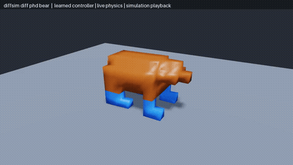
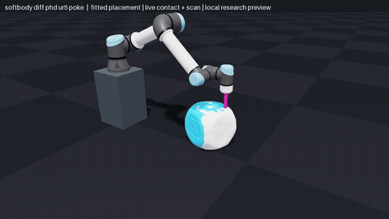

<!-- Generated by tools/build_readme.py; edit pyproject.toml and the sources in docs/. -->
# newton-solver-diff-phd

Differentiable implicit tetrahedral mechanics with frictional contact for Newton.

## Run

From this directory:

```bash
./docker/build.sh
./docker/run.sh                 # Choose an automatically discovered example.
./docker/run.sh --list          # List examples without Docker or GPU access.
./docker/run.sh <example>       # Run one example.
```

For local development:

```bash
uv sync --locked --extra examples
uv run --locked python -m newton_solver_diff_phd.examples
```

Linux x86-64 or ARM64, Python 3.12. CUDA runs need an NVIDIA driver compatible with the locked CUDA 13 Warp wheel; Docker GPU runs also need NVIDIA Container Toolkit. Use `--cpu --headless` before the example name for supported CPU scenes. Visual Docker runs use the local X11 display and a readable `XAUTHORITY` file. Use `./docker/run.sh -- COMMAND ...` for an arbitrary container command. Source is mounted from this directory; rebuild after changing dependencies.

## Dependencies

Installed runtime packages: `newton==1.7.0`, `warp-lang==1.17.0`, `numpy>=2,<3`. No sibling solver package or external source checkout is required. The `examples` extra supplies the viewer and any USD/robot dependencies; `uv.lock` fixes their versions. Example-specific data requirements are listed below.

## Profiling

```bash
./docker/run.sh --nsys --list
./docker/run.sh --nsys <example>
./docker/run.sh --nsys --all
```

Install NVIDIA Nsight Systems on the host; set `NSYS_ROOT` if its installation is not discovered. The profiler runs only examples with README videos, using their recorded settings and scripted interactions. It captures fresh initialization/training and live simulation after independent warmup, with solver/linear-solve/gradient phase markers. The default null viewer retains visualization preparation; add `--viewer gl` to include drawing.

Reports, completion metadata and local history are saved under `nsys/results/` and ignored by Git. See [profiling instructions](nsys/README.md) for local setup, comparisons and reading bottlenecks. Ordinary runs have no profiling instrumentation; captured timings include profiler overhead.

## Example controls and local data

The standard launcher discovers two examples. After `./docker/build.sh`, run
`./docker/run.sh` to select one, or pass its name directly.

```bash
./docker/run.sh diffsim_diff_phd_bear
./docker/run.sh diffsim_diff_phd_bear --trained
./docker/run.sh softbody_diff_phd_ur5_poke --recording /workspace/recording_debug.json
```

Bear training optimizes sixteen periodic muscle weights and displays the current
trajectory. `--trained` advances fresh physics with the bundled controller.
Use `--save-controller PATH` during training and `--load-controller PATH` for
later inference. Displayed training trajectory replay is not a speed benchmark.

The UR5 example requires your authorized, prepared PokeFlex recording. Its
optional local default is `examples/assets/pokeflex_local/recording_debug.json`.
The JSON manifest contains relative `geometry`/`recording` paths and SHA-256
checksums; keep `die.usdc`, `recording_debug.npz` and the manifest together. A
prepared self-contained NPZ is also accepted. The loader requires rest vertices,
tetrahedra, boundary triangles, pinned nodes, display vertices/triangles/UVs,
fixed tetrahedral embedding, observation frame IDs, target samples and indices,
and the initial XY placement. Missing data produces an explicit error.

Private scans and derived geometry are excluded from release packages and
Docker images; local checkout mounts can access your copy. Use only media
permitted by your dataset access terms. Asset attribution/access notices are in
`src/newton_solver_diff_phd/examples/assets/NOTICE.md`.

Use `--fit-mode position`, `stiffness`, or `compressibility` to fit one parameter
group at a time. `--show-target` overlays the recorded surface. Training saves
`--save-alignment PATH`; `--load-alignment PATH` runs fresh untaped inference.
The default prepared scene uses 109 die nodes/362 tets and one step per 30 Hz
observation. The optional `--reference` mode expects a separately prepared,
higher-resolution recording; it is not included, and uses 30 substeps with
0.30 retained velocity by default. The robot is prescribed visualization and
the physical probe has fixed motion; there is no two-way robot reaction solve.

The retained full-recording gradient check misses its strict 1% gate in one
coordinate. See [validation](docs/validation.md) before using those fitted values
as an accuracy result.

## Recording the examples

`python tools/record_examples.py --all` uses `docs/videos.json`. Bear capture
uses the bundled controller. Poke capture additionally requires
`outputs/diff_phd_poke/alignment_fast.json`, created by running its training mode
against the same prepared recording. The supplied local alignment fits XY
placement; it does not certify the Young modulus or Poisson ratio.

Poke previews include the private scanned surface. The [dataset access
terms](https://pokeflex.ait.ethz.ch/) restrict use to noncommercial academic
purposes and prohibit redistribution of the dataset and converted models.
These files are local research previews; the terms do not explicitly grant
redistribution rights for rendered movies. No media upload is performed by the
recording tool.

## Differentiable heterogeneous tetrahedral mechanics

`SolverDiffPhD` uses Tet4 rest gradients, lumped mass and SI units. State arrays
are Newton float32 particles; constitutive evaluation, sparse solves and
adjoints use float64. Zero inverse mass pins a node, optionally with prescribed
velocity. Native rigid dynamics, springs and triangle elasticity are excluded.

The [paper-to-code mapping](docs/papers.md) identifies the implemented portions of
DiffPhD, Fast But Accurate and DiffPD, including their algorithm steps and
explicit differences from the published methods.

## Energy and discrete residual

For $F_e=D_sD_m^{-1}$ and $J_e=\det F_e>0$, Neo-Hookean mode uses

$$
E(q)=\sum_e V_e\psi_e(F_e),\qquad
\psi_e(F)=\frac{\mu_e}{2}\bigl(\mathrm{tr}(F^TF)-3\bigr)
-\mu_e\log J+\frac{\lambda_e}{2}(\log J)^2.
$$

Projective mode instead uses weighted distance-to-rotation and volume projection
energies. Optional fixed fibre directions add activation-controlled energies.
The material mode changes the physical energy, not only the preconditioner.
For timestep $h$, mass damping $c$, forces $f$, and contact Jacobian $G$, the
backward-Euler mechanics residual is

$$
r_q=\frac{M}{h^2}(q^+-q-hv)+\frac{cM}{h}(q^+-q)
+\nabla E(q^+)-f-Mg-G^Tr=0,\qquad v^+=(q^+-q)/h.
$$

Position-level contact enforces compliant Signorini complementarity
$0\le r_n\perp(g_n+\varepsilon r_n)\ge0$ and a Coulomb friction cone
$\|r_t\|\le\mu_f r_n$, with sticking or sliding selected by the contact solve.
Geometry comes from a configured plane or swept vertex–face/edge–edge detection.
Nonadjacent features can represent self/contact between soft bodies. Newton's
native `Contacts` are not consumed; rendered plane shapes do not configure the
physical plane automatically.

A constant projective stiffness based on $2\mu_e+\lambda_e$, inertia and damping
preconditions the iterations. Sparse inverse factors are prepared with NumPy
and applied in Warp; material/mass/timestep changes rebuild them. This matrix
is not substituted for the physical residual Jacobian in the adjoint. Default
scaled mechanics/contact tolerances are $10^{-7}$/$10^{-9}$ m; examples may
choose explicit tolerances. Nonconvergence raises `ConvergenceError`.

## Implicit derivatives

For converged coupled state $z=(q^+,r)$ and input $\theta$, write
$R(z,\theta)=0$. Reverse differentiation solves

$$
R_z^Ta=\nabla_z L,\qquad
\nabla_\theta L=\partial_\theta L-R_\theta^Ta.
$$

Position, velocity, external forces, Lamé coefficients and fixed-fibre activation
have VJPs. Contact feature IDs, barycentric coordinates, normals and stick/slip
branches are frozen. Rest geometry, mass, timestep, damping, friction and fibre
geometry are fixed. There is no derivative through contact creation or topology.
Owned primal/material/contact snapshots prevent later steps overwriting taped
inputs. True linear residuals are checked. Taped output states must be distinct.

The bear has 276 nodes/768 tetrahedra, eight fibre groups and sixteen sine/cosine
weights: $u_g(t)=0.3\tanh(a_g\sin(4\pi t)+b_g\cos(4\pi t))$.
It optimizes forward mass-centre velocity with lateral/vertical and controller
penalties over 100 steps of 0.008 s. The bundled controller runs fresh inference.
The UR5 example fits placement or one material parameter against authorized
local PokeFlex scans using a nearest-vertex Chamfer loss. Nearest associations
are frozen per backward pass. The robot is prescribed kinematics; the probe
provides no two-way rigid coupling.

Whole-step CUDA graph capture is unsupported because outer convergence and
geometry refresh use host decisions; inner conditional graphs are used. Warp
Tape/runtime hooks require the pinned Warp version. See [validation](docs/validation.md)
for numerical checks and the recorded-poke gradient limitation, and
[usage](docs/usage.md) for the recording prerequisite and example commands.

## Papers mapped to this implementation

The methods below are linked to executable code, with departures stated explicitly.

| Paper | Implemented portion and code |
| --- | --- |
| Lai et al., [DiffPhD (2026)](https://arxiv.org/abs/2605.14526), Algorithms 1–2, §§4.3–4.8 | Material-weighted sparse preconditioning, persistent inverse factors, bounded Anderson acceleration, contact response and implicit adjoints. See the mapping below. The complete published algorithm is **not** reproduced. |
| Zeng et al., [Fast But Accurate (2025)](https://doi.org/10.1145/3730834), Algorithm 4, §§4–6 | Sparse inverse-factor applications and reusable contact compliance in [SparseInverse](src/newton_solver_diff_phd/_src/solvers/diff_phd/sparse.py) and [ContactResponse](src/newton_solver_diff_phd/_src/solvers/diff_phd/response.py). This implementation uses natural-map friction residuals and safeguarded Newton solves, rather than the paper's exact NCP/CR pipeline. |
| Du et al., [DiffPD (2021)](https://doi.org/10.1145/3490168), Algorithms 1–2, §4 | Projective rotation/volume derivatives in [elasticity.py](src/newton_solver_diff_phd/_src/solvers/diff_phd/elasticity.py); fixed-point dynamics and the converged-system adjoint in [solver.py](src/newton_solver_diff_phd/_src/solvers/diff_phd/solver.py) and [adjoint.py](src/newton_solver_diff_phd/_src/solvers/diff_phd/adjoint.py). Its static-contact Woodbury Algorithm 4 is not used. |

## DiffPhD pseudocode to code

| Paper step | Current implementation |
| --- | --- |
| Algorithm 1, 1–6: assemble and cache the material-dependent factor | [SolverDiffPhD._prepare](src/newton_solver_diff_phd/_src/solvers/diff_phd/solver.py) builds the scalar nodal matrix with per-element weight $2\mu_e+\lambda_e$; [SparseInverse.__init__](src/newton_solver_diff_phd/_src/solvers/diff_phd/sparse.py) creates exact sparse LDLT inverse factors; `apply`/`apply_batch` use them on the selected device. |
| Algorithm 1, 7–10: predictor and contact columns | [kernels.predictor](src/newton_solver_diff_phd/_src/solvers/diff_phd/kernels.py), [ContactResponse.update](src/newton_solver_diff_phd/_src/solvers/diff_phd/response.py), `make_columns` and `make_compliance`. The compliance matrix is rebuilt when frozen contact geometry changes. |
| Algorithm 1, 12–19: mechanics and constrained update | [SolverDiffPhD._solve](src/newton_solver_diff_phd/_src/solvers/diff_phd/solver.py) applies the inverse to the physical force residual, then [ContactResponse.solve](src/newton_solver_diff_phd/_src/solvers/diff_phd/response.py) proposes the frictional correction. `material="pd"` has local rotation/volume projections; `neo_hookean` uses the logarithmic energy gradient. The latter does **not** execute the paper's proximal local step. |
| Algorithm 1, 20–32: acceleration and acceptance | [_solve](src/newton_solver_diff_phd/_src/solvers/diff_phd/solver.py) implements bounded regularized Anderson mixing for contact-free iterations, checks both force residual and update size, and falls back to [_newton_candidate](src/newton_solver_diff_phd/_src/solvers/diff_phd/solver.py) with a physical KKT tangent. This differs from the paper's dual-gate stopping rule. |
| Algorithm 1, 33–34: state and backward cache | [kernels.write_state](src/newton_solver_diff_phd/_src/solvers/diff_phd/kernels.py), then [record_adjoint](src/newton_solver_diff_phd/_src/solvers/diff_phd/adjoint.py) stores independent primal/contact snapshots only when a Tape tracks the step. |
| Algorithm 2, 1, 16 onward: seed, transpose solve and parameter gradients | [record_adjoint.backward](src/newton_solver_diff_phd/_src/solvers/diff_phd/adjoint.py), `_seed`, [KKTSystem.solve(transpose=True)](src/newton_solver_diff_phd/_src/solvers/diff_phd/adjoint.py), `_position_vjp`, `_velocity_vjp`, `_force_vjp` and `elasticity.material_vjp`. The matrix-free solve checks its true residual and uses the existing inverse as a preconditioner. |
| Algorithm 2, 2–15: trust-region filtered proximal Hessian | **Not implemented in the stepping adjoint.** [KKTSystem](src/newton_solver_diff_phd/_src/solvers/diff_phd/adjoint.py) uses the unfiltered physical tangent. Standalone [neohookean_prox*](src/newton_solver_diff_phd/_src/solvers/diff_phd/elasticity.py) routines exist but are not called by `SolverDiffPhD.step`. |

The paper's stiffness-scaled Rayleigh term is also absent: `mass_damping` is
mass-proportional only. No-contact backward still solves the physical tangent;
it does not reduce to one inverse application. Contact detection and branch
selection are held fixed during differentiation. See [method](docs/method.md) for
the exact equations and [validation](docs/validation.md) for measured checks.

## Examples

One demonstration clip per example. Click a preview to open its MP4. Videos show simulated motion rendered offline; playback rate is not a performance measurement.

| Example | Example |
| --- | --- |
| **[diffsim_diff_phd_bear](src/newton_solver_diff_phd/examples/example_diffsim_diff_phd_bear.py)**<br>Optimize periodic leg-muscle commands for a native DiffPhD bear gait.<br><a href="docs/media/diffsim_diff_phd_bear.mp4"></a><br>Live simulation with the bundled learned muscle controller: resolution-10 bear, 276 nodes and 768 tetrahedra; playback at 60 fps, not a real-time benchmark.<br>`./docker/run.sh diffsim_diff_phd_bear` | **[softbody_diff_phd_ur5_poke](src/newton_solver_diff_phd/examples/example_softbody_diff_phd_ur5_poke.py)**<br>Fit a die&#x27;s placement, stiffness or compressibility to PokeFlex deformations.<br><a href="docs/media/softbody_diff_phd_ur5_poke.mp4"></a><br>Live deformable contact with the fitted die placement, prescribed UR5 motion and a translucent recorded scan. Requires private PokeFlex data and a locally trained alignment checkpoint; material values are not experimentally verified.<br>`./docker/run.sh softbody_diff_phd_ur5_poke` |

## Regenerate documentation

```bash
python3 tools/build_readme.py
python3 tools/build_readme.py --check
uv run --locked python tools/record_examples.py --all
python3 tools/build_readme.py --require-videos
```

README generation uses only Python's standard library and discovers examples from their launcher. Recording needs the `examples` extra, `ffmpeg`, and OpenGL. `docs/videos.json` stores optional capture arguments; it does not define the example list. `tools/video_scenarios.py`, when present, scripts interactions for recording. Each clip has a metadata file recording arguments, frame count and capture conditions.

## Validate

```bash
uv run --locked ruff check .
uv run --locked ruff format --check .
uv run --locked python -m unittest discover -s tests -v
NEWTON_TEST_DEVICE=cuda:0 uv run --locked python -m unittest discover -s tests -v
uv build
```

See [validation scope and results](docs/validation.md).

License: [Apache-2.0](LICENSE). Required third-party attribution is in [THIRD_PARTY_NOTICES.md](THIRD_PARTY_NOTICES.md).
